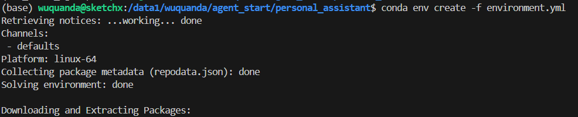
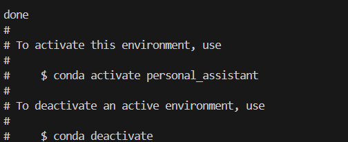
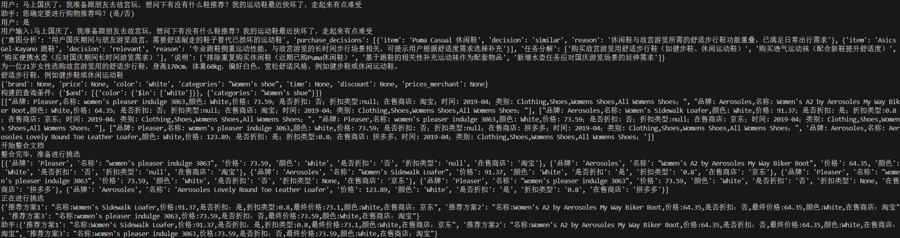

# readme
1. 首先配置`deepseek API`环境变量。

    ·  在`~/.bashrc`文件下写入下列代码

        export api_key="your_api_key_here"
    之后使用`source ~/.bashrc`重启终端

    · 在命令行直接使用(暂时)

        export api_key="your_api_key_here"

2. 使用` environment.yml `文件创建所需要的环境

        conda env create -f environment.yml

    结果如下
    

    

    使用conda命令激活刚刚创建的环境

        conda activate personal_assistant

    

3. 运行`chat2.py`执行

    