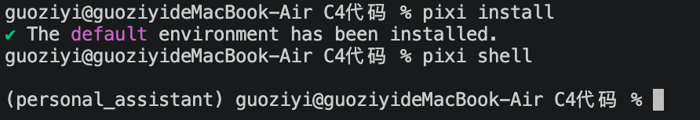
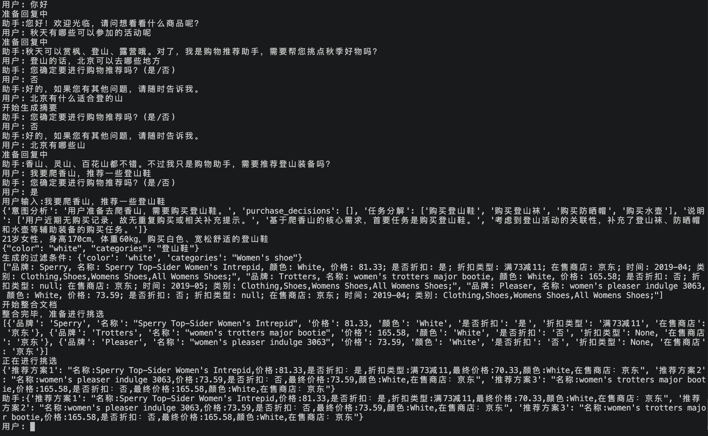
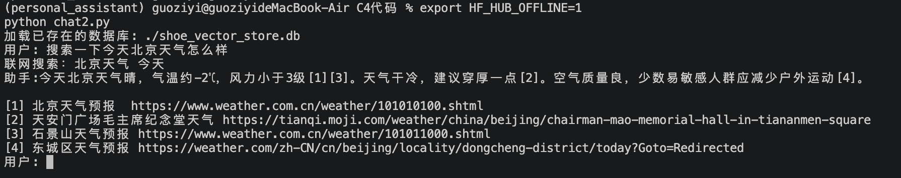

# 大语言模型智能体实验报告

## 一、实验目的

基于课程提供的Agent示例代码（个性化鞋类购物推荐助手），学习大语言模型智能体的基本原理、系统架构及实现方法。具体包括：

1. 完成Python环境搭建、依赖安装与大模型API配置；
2. 阅读核心代码，理解提示词设计、工具调用、知识检索与记忆管理四项基本功能的实现；
3. 运行示例程序，测试各项功能并分析执行流程；
4. 在现有代码基础上扩展至少一项智能体功能。

## 二、环境配置

### 2.1 将conda环境改写为pixi环境

示例代码附带的`environment.yml`是在Linux服务器（`/data1/wuquanda/miniconda3/envs/zmb_multi_agent`）上导出的conda环境，直接在macOS上执行`conda env create`会遇到两个问题：

- 文件中锁定了`nvidia-cublas-cu12`、`triton`等十余个CUDA相关包的精确版本，这些包只在Linux上存在，macOS无法安装；
- conda侧的系统库（`libgcc-ng`、`ld_impl_linux-64`等）同样带有Linux专属的build字符串。

本实验改用pixi管理环境。pixi是基于conda生态的项目级包管理器，环境定义写在项目目录下的`pixi.toml`中，并通过`pixi.lock`锁定每个平台的精确版本，环境本身安装在项目目录下的`.pixi/`中，不污染全局。改写要点如下：

```toml
[workspace]
channels = ["conda-forge"]
platforms = ["osx-arm64", "linux-64"]

[dependencies]
python = "3.10.*"
packaging = "24.2.*"

[pypi-dependencies]
langchain = "==0.3.26"
langchain-core = "==0.3.68"
langchain-chroma = "==0.2.4"
langchain-deepseek = "==0.1.3"
langchain-huggingface = "==0.3.0"
chromadb = "==1.0.15"
sentence-transformers = "==5.0.0"
torch = "==2.7.1"
scikit-learn = "==1.7.0"
# ……其余包版本与environment.yml保持一致
```

改写时遵循三条原则：

1. conda侧只保留Python解释器，所有应用依赖走PyPI，与原环境"conda建基础环境、pip装应用包"的结构一致；
2. 版本号与`environment.yml`逐项对应，保证行为可复现；
3. CUDA相关包不写入配置，由PyPI按平台自动选择：Linux上安装torch会自动带入CUDA依赖，macOS上则安装CPU/MPS版本。

同一份`pixi.toml`同时声明了`osx-arm64`和`linux-64`两个平台，锁文件中包含两个平台各自的解析结果，因此同一个项目目录在本机和实验室服务器上都可以直接`pixi install`。

### 2.2 配置过程中遇到的问题

**问题一：拉取repodata时连接被中断。** 首次`pixi install`报错`peer closed connection without sending TLS close_notify`，原因是国内直连`conda.anaconda.org`与`prefix.dev`不稳定。解决方法是在`~/.pixi/config.toml`中配置镜像：

```toml
[mirrors]
"https://conda.anaconda.org/conda-forge" = ["https://mirrors.tuna.tsinghua.edu.cn/anaconda/cloud/conda-forge"]
"https://prefix.dev/conda-forge" = ["https://mirrors.tuna.tsinghua.edu.cn/anaconda/cloud/conda-forge"]

[pypi-config]
index-url = "https://pypi.tuna.tsinghua.edu.cn/simple"
```

**问题二：`packaging`版本冲突。** 配置镜像后报错`langchain-core==0.3.68 depends on packaging>=23.2,<25 and packaging==26.3`。原因是最初在conda侧写了`pip = "*"`，conda-forge的pip包连带引入了conda版`packaging 26.3`，而conda侧的包在PyPI解析阶段被视为固定版本、不可降级。解决方法是去掉conda侧的`pip`（pixi使用内置的uv安装PyPI包，不依赖pip），并显式将`packaging`钉在原环境的24.2版本。

**问题三：大模型API配置。** 示例代码通过环境变量`api_key`读取DeepSeek密钥（`new_test_deepseek.py`第15行`os.getenv(key='api_key')`），运行前执行`export api_key="……"`即可。

### 2.3 环境验证

`pixi install`完成后，用`pixi shell`进入环境（等价于`conda activate`），提示符前出现环境名`(personal_assistant)`。`pixi.toml`中另定义了`pixi run check`任务，用于导入torch、chromadb、langchain、sentence_transformers等核心包并打印版本。



图1　pixi环境安装与激活

## 三、代码学习

### 3.1 系统架构

示例系统的入口是`chat2.py`，整体为"意图路由+固定流水线"的结构：

```
用户输入
  └─ intent_recognition（LLM判断意图）
       ├─ 0 闲聊 ──► run_chat：带历史记忆的对话，超过阈值自动摘要
       └─ 1 购物 ──► 终端二次确认 ──► run_workflow
                        ├─ Decision_Agent        任务分解（结合购买记录）
                        ├─ RecQueryComposer      查询润色（注入用户画像与偏好）
                        ├─ Search_agent          混合检索（SQL过滤+向量相似度）
                        └─ Multi_Platform_Agent  结果格式化与性价比排序
```

需要说明的是，这里的"多Agent"是四个Python类各自封装一段专用提示词、按固定顺序串联，没有工具自主选择或动态规划，控制流完全由`run_workflow`函数写死。所有Agent共用一个`DeepSeekChat`实例，该类继承LangChain的`BaseChatModel`，封装了`langchain_deepseek.ChatDeepSeek`，并在`_generate`中只保留最近5条消息。

### 3.2 提示词设计

各Agent的提示词有三个共同特点：

1. **角色设定加任务说明。** 每个提示词开头明确"你是一个××助手"，再说明输入是什么、要做什么。
2. **少样本示例。** `intent_recognition`给出5组"历史摘要+用户输入→输出"示例，其中第4、5组刻意使用同一句用户输入、不同的历史摘要、不同的输出，让模型学会结合上下文判断。`Decision_Agent`给出两个完整的JSON输出示例，覆盖"已买过类似商品需排除"和"需补充相关商品"两种情形。
3. **严格的输出格式约束。** 要求"只输出JSON，不要其他内容"或"只输出1或0"，配合`extract_json_from_model_output`函数用正则抠出代码块中的JSON再解析，解析失败时返回空字典，保证下游代码不崩溃。

以`Search_agent`的提示词为例，它把支持的字段表与操作符表以JSON形式嵌入提示词，并给出三组"自然语言→过滤字典"的示例，让模型完成从自然语言到结构化查询的转换：

```
用户输入："找找耐克品牌的价格低于500元并且有折扣的运动鞋"
输出：{"brand": "nike", "price": {"$lt": 500}, "discount": "是", "categories": "Women's shoe"}
```

### 3.3 工具调用

示例代码中的"工具"不是函数调用（function calling）意义上的工具，而是Agent内部对外部系统的直接调用，主要有三处：

- **SQLite数据库**：`SQLiteVectorStore`通过`sqlite3`读写`shoe_vector_store.db`，`Search_agent`将LLM生成的过滤字典翻译为SQL的`WHERE`子句（`$lt`→`<`，`$in`→`IN (…)`）；
- **嵌入模型**：`SentenceTransformer('sentence-transformers/all-MiniLM-L6-v2')`用于把查询语句编码为384维向量；
- **本地文件**：`Decision_Agent`读取`user_memory/001.json`中的购买记录，`RecQueryComposer`读取`personal_inf.json`中的用户画像。

模型与工具的衔接方式是"LLM生成结构化参数，Python代码执行调用"，这与function calling的思路一致，只是参数格式由提示词而非API协议约定。

### 3.4 知识检索

`Search_agent`实现了结构化过滤与向量检索结合的两阶段混合检索：

1. **存储结构。** `documents`表的每一行同时存放商品描述文本`content`、该文本的嵌入向量（float32二进制BLOB）以及`brand`、`color`、`price`、`time`、`discount`、`prices_merchant`等结构化列，并对结构化列建立索引。
2. **粗筛。** LLM把润色后的查询转为过滤字典，代码拼接成SQL，从表中筛出满足硬约束（品牌、价格区间、是否折扣等）的候选集。
3. **精排。** 对查询语句做嵌入，逐条把候选行的BLOB还原为numpy向量，计算余弦相似度，按相似度降序取前k条（k=3），返回其`content`文本。

这种设计的优点是硬约束走SQL精确命中且可利用索引，模糊语义（"适合登山、宽松舒适"）交给向量匹配。局限是精排阶段对候选集做全量遍历而非近似最近邻索引，数据量增大后性能会下降。另外代码目录中还保留了基于Chroma向量库的旧版实现（`search_agent2.py`与三个`*_chroma_dbs`目录），在`chat2.py`中已被注释掉。

### 3.5 记忆管理

示例代码包含三种粒度的记忆：

| 类型 | 载体 | 更新方式 |
|---|---|---|
| 短期对话记忆 | `ChatMessageHistory`，按`session_id`存于内存字典`store` | 由`RunnableWithMessageHistory`在每轮对话后自动追加 |
| 对话摘要 | 同上 | `maybe_summarize`：消息数超过阈值（3条）时，让LLM生成要点摘要，清空历史后只保留一条"（对话摘要）……" |
| 长期用户记忆 | `personal_inf.json`（画像与偏好）、`user_memory/001.json`（购买记录） | 读取：每次购物流程读取；写入：`RecQueryComposer.update_prefer`可从对话中提取新偏好写回，但未接入主流程 |

短期记忆与摘要的组合是一种滑动窗口加压缩的长对话方案，目的是控制每次请求的token消耗。长期记忆在购物流程中有两处使用：`Decision_Agent`用最近90天的购买记录做推荐去重与补全，`RecQueryComposer`把性别、年龄、身高、体重与颜色、风格偏好注入查询语句，这是系统"个性化"的来源。

## 四、运行实践

### 4.1 执行流程分析

图2是一次完整的运行记录，依次经过了闲聊分支、意图误判与二次确认、对话摘要，最后进入购物工作流。



图2　闲聊分支与购物分支运行结果

**闲聊分支。** 输入"你好"和"秋天有哪些可以参加的活动呢"均被判为普通对话，由`run_chat`回答。第二个回答"秋天可以赏枫、登山、露营哦。对了，我是购物推荐助手，需要帮您挑点秋季好物吗？"体现了系统提示词中"回答与购物无关的问题后隐晦提醒用户自己是购物助手"的要求。

**意图识别的误判与二次确认。** "登山的话，北京可以去哪些地方"和"北京有什么适合登的山"两句本身没有购买意图，但都被判为购物意图。原因是意图识别提示词把历史摘要一并交给模型，而此前的对话已经出现"登山"，模型按示例4的逻辑（结合上下文推断可能购物）给出了1。这两次误判都被终端的"您确定要进行购物推荐吗？"二次确认拦下，用户回答"否"后系统正常继续，说明确认步骤在实践中是必要的。中间出现的"开始生成摘要"表示消息数超过阈值，`maybe_summarize`把历史压缩成了一条摘要。

**购物分支。** 输入"我要爬香山，推荐一些登山鞋"，确认后进入`run_workflow`，各级输出如下。

1. `Decision_Agent`输出的JSON中`purchase_decisions`为空列表，"说明"字段为"用户近期无购买记录，故无重复购买或相关补充提示"。这印证了4.2节末尾指出的问题：示例数据中的购买记录均为2025年5至7月，被90天过滤条件全部排除，去重逻辑没有生效。任务分解结果为`["购买登山鞋", "购买登山袜", "购买防晒帽", "购买水壶"]`，模型根据登山场景自行补充了三项辅助装备。
2. `RecQueryComposer`将"购买登山鞋"润色为"21岁女性，身高170cm，体重60kg，购买白色、宽松舒适的登山鞋"，用户画像中的性别、年龄、身高、体重与颜色、风格偏好均被注入。
3. `Search_agent`中模型生成的过滤条件为`{"color": "white", "categories": "登山鞋"}`，代码随后把`categories`强制覆盖为`"Women's shoe"`（商品库中该字段只有这一个取值），最终过滤条件为`{'color': 'white', 'categories': "Women's shoe"}`。可以看到"登山"这一语义约束没有进入SQL过滤，只能依靠后续的向量相似度体现；润色语句中的身高体重等信息对检索也没有实际作用。SQL粗筛后按向量相似度返回3条白色女鞋，均来自京东。
4. `Multi_Platform_Agent`把3条文本格式化为3个JSON对象（修复后每条一次调用），再由模型按最终价格排序：第一条商品原价81.33、折扣"满73减11"，模型正确算出最终价格70.33并排在首位，其余两条无折扣，按价格73.59、165.58依次排列。

一次完整购物流程约需7到10次模型调用（意图识别1次、任务分解1次、查询润色1次、过滤条件生成1次、格式化3次、排序1次，另有可能触发的摘要）。

### 4.2 运行过程中发现并解决的问题

示例代码在本机环境下无法直接运行，依次排查并解决了以下问题。

**问题一：缺少`transform_.py`。** `search_agent2.py`第6行`from transform_ import to_json, from_json`，但代码包中只有`__pycache__/transform_.cpython-310.pyc`，没有源码，导致`import search_agent2`失败。通过`marshal`加载pyc并用`dis`反汇编，确认两个函数的逻辑分别是`json.dumps({"data": input}, ensure_ascii=False)`与`json.loads(input)["data"]`，据此还原出`transform_.py`。

**问题二：`User_Prefer_Agent`未定义。** `chat2.py`第138行实例化了该类，但没有对应的import语句，代码包中同样只有`user_prefer.cpython-310.pyc`。由于该对象在后续代码中从未被使用，将该行注释掉。`__pycache__`中另有`decision_agent`、`recommend_agent`、`search_agent1`、`virtual_test_agent`等无源码的pyc，判断是示例代码打包时遗漏了部分文件。

**问题三：硬编码的服务器路径。** `chat2.py`中`user_info_path`为`/data1/wuquanda/agent_start/personal_assistant/personal_inf.json`，改为相对路径`./personal_inf.json`。其他文件中的同类路径均位于各自的`if __name__ == "__main__"`块中，不影响主程序。

**问题四：中文输入导致`UnicodeEncodeError: surrogates not allowed`。** 向DeepSeek发送请求时报错，定位到提示词中含有代理字符`\udce8`。原因是`chat2.py`使用裸`input()`读取输入，未导入`readline`模块，行编辑交由macOS终端驱动处理，而该驱动按字节删除：一个汉字占3字节，按一次退格只删1字节，残留的字节序列不是合法UTF-8，被Python以`surrogateescape`方式解码为代理字符。解决方法是在文件开头`import readline`，并在读入后执行`user_input.encode("utf-8", "surrogateescape").decode("utf-8", "ignore")`丢弃残缺字节。

**问题五：嵌入模型下载失败。** `SentenceTransformer`初始化时报`TypeError: expected str, bytes or os.PathLike object, not NoneType`，实际原因是无法连接HuggingFace下载`all-MiniLM-L6-v2`，sentence-transformers内部吞掉了下载异常并返回`None`。解决方法是设置`HF_ENDPOINT=https://hf-mirror.com`走国内镜像，下载完成后可用`HF_HUB_OFFLINE=1`离线加载。

**问题六：`Multi_Platform_Agent`整合阶段耗时极长。** `run`方法假设输入为`list[list[str]]`（按平台分组的商品列表），写了两层循环；但`Search_agent.run`返回的是`list[str]`，第二层循环实际遍历的是字符串中的每一个字符，`merge_docs`对每个字符调用一次LLM。3条约150字的商品描述会触发约450次API请求，且格式化结果基本为空字典，后续排序也失去意义。修复方法是在`run`中先把输入展平为一条条商品描述，再以`[[doc]]`的形状传给`merge_docs`，使每条商品只触发一次格式化调用。用模拟LLM验证，3条商品的调用次数由数百次降为3次（另加排序1次）。该问题在原作者的单元测试中没有暴露，是因为测试用例恰好使用了两层列表。

此外代码中还存在两处逻辑问题，本次未修改但在此说明：`Decision_Agent.recent_purchases`以当前时间减90天为截止，而示例数据中的购买记录均为2025年5至7月，在当前日期下会被全部过滤，去重逻辑实际不生效；`run_workflow`的`for`循环体内直接`return`，即使分解出多个鞋类任务也只处理第一个。

## 五、功能扩展

### 5.1 新增联网搜索功能

示例系统的全部知识来自本地商品库与模型自身，无法回答天气、近期活动、商品最新评测等依赖实时信息的问题。本次扩展接入DeepSeek官方的Search API，使智能体具备联网查询能力。

**接口选择。** DeepSeek于2026年8月开放了API层面的联网搜索，接口为`POST https://api.deepseek.com/v1/tools/search`，与chat接口共用同一个API Key，因此无需申请额外的搜索服务。该接口是独立的REST接口而非chat接口内置的自动工具，需要由开发者自行调用并把结果交给模型，这与示例代码"LLM生成参数、Python执行调用"的工具使用方式一致。请求体为`{"query": …, "count": …, "need_content": …}`，`query`限1到128字符；返回`results`数组，每条含`title`、`url`、`snippet`、`summary`、`date`、`site_name`等字段。计费为每1000次成功请求0.75美元，空结果与失败请求不计费。

**实现。** 新增`web_search_agent.py`，定义`Web_Search_Agent`类，与其他Agent保持相同的接口风格：

```python
class Web_Search_Agent:
    SEARCH_URL = "https://api.deepseek.com/v1/tools/search"

    def __init__(self, llm, api_key=None, count=5, timeout=30): ...

    def search(self, query, count=None, need_content=False):
        # POST到Search API，Bearer头使用环境变量api_key，返回results列表
        ...

    def compose_query(self, user_input, history=""):
        # LLM把用户问题改写为不超过30字的搜索关键词
        ...

    def answer(self, user_input, history=""):
        # 关键词 -> 搜索 -> 把结果整理成带编号的文本 -> LLM基于结果回答并以[编号]标注来源
        # 搜索接口异常时回退为不联网回答
        ...
```

`chat2.py`的改动有三处：

1. 意图识别由二分类扩展为三分类，提示词中新增类别说明与示例：`0`为普通闲聊，`1`为购物意图，`2`为需要联网查询，并规定购物意图优先于联网查询；
2. 主循环新增`intent == 2`分支，调用`websearch_agent.answer(user_input, history_context)`，回答写入对话历史并参与摘要压缩；
3. 实例化`websearch_agent = Web_Search_Agent(llm)`。

扩展后的数据流为：

```
"北京这周末适合爬山吗"
  → intent_recognition → 2
  → compose_query → "北京 周末 天气 爬山"            （模型调用1次）
  → POST /v1/tools/search {"query": …, "count": 5}   （搜索1次）
  → format_results → "[1] 标题（站点，日期）\n摘要……\n链接……"
  → 回答提示词（搜索结果+历史摘要+问题）              （模型调用1次）
  → "周末北京晴，适合爬山[1]。\n[1] 北京天气预报 https://……"
```

**验证。** 使用模拟LLM与模拟HTTP响应对正常路径与接口失败路径分别测试：正常路径下请求地址、鉴权头与请求体正确，搜索结果被正确拼入回答提示词，总计2次模型调用；接口返回402时正确回退为不联网回答并给出提示。

图3是联网搜索分支的实际运行结果。输入"搜索一下今天北京天气怎么样"被判为类别2，`compose_query`生成的关键词为"北京天气 今天"，模型基于搜索结果给出了气温、风力、空气质量等信息，并以`[1][3]`、`[2]`、`[4]`标注了各句的来源，末尾列出4条来源的标题与链接。运行前设置了`HF_HUB_OFFLINE=1`，嵌入模型从本地缓存加载。



图3　联网搜索分支运行结果

### 5.2 对现有功能的优化

第四节问题六中对`Multi_Platform_Agent.run`的修复同样属于功能优化：在不改变提示词与输出格式的前提下，把整合阶段的模型调用次数从与字符数成正比降为与商品条数相等，使购物流程的整合阶段从数分钟缩短到数秒，并使后续的性价比排序建立在正确的格式化结果之上。

## 六、总结

本实验完成了从环境配置、代码阅读、运行调试到功能扩展的完整过程。主要收获有三点。

第一，对大语言模型智能体的实现方式有了具体认识。示例系统的"多Agent"本质是多段专用提示词的串联，模型负责理解自然语言并产出结构化参数（意图编号、任务列表、过滤字典、JSON格式的商品信息），Python代码负责执行确定性的工具调用（SQL查询、向量计算、文件读写、HTTP请求）并控制流程。提示词设计的核心是角色设定、少样本示例与严格的输出格式约束三者配合，再辅以容错的解析函数。

第二，调试过程比预期复杂，问题分布在环境、网络、代码三个层面：conda到pixi的迁移需要处理平台差异与conda和PyPI两套解析器的交互；镜像配置解决了国内访问conda-forge、PyPI与HuggingFace的网络问题；代码层面既有打包遗漏（缺失源码文件）、环境耦合（硬编码路径）这类工程问题，也有输入编码、数据形状不匹配这类需要逐层追踪才能定位的逻辑问题。其中整合阶段逐字符调用LLM的问题说明，基于LLM的系统中一个数据形状错误可能不会报错，而是以极慢的速度与无意义的输出表现出来，需要通过观察调用次数与中间结果来发现。

第三，功能扩展的关键是与现有架构保持一致。联网搜索以独立Agent类的形式加入，复用同一个LLM实例与同一个API Key，通过扩展意图分类接入主循环，没有改动其他Agent。

## 附录：提交文件清单

| 文件 | 说明 |
|---|---|
| `pixi.toml`、`pixi.lock` | pixi环境定义与锁文件（osx-arm64、linux-64） |
| `README_pixi.md` | pixi环境使用说明 |
| `transform_.py` | 按pyc字节码还原的缺失模块 |
| `chat2.py` | 主程序；修改了导入、意图识别、联网分支、路径与输入处理，原文件备份为`chat2.py.bak` |
| `multiplatform_agent.py` | 修复了`run`方法的输入形状问题，原文件备份为`multiplatform_agent.py.bak` |
| `web_search_agent.py` | 新增的联网搜索Agent |
| `环境配置与激活.png`、`运行结果.png`、`新加联网搜索功能-演示.png` | 运行截图，分别对应正文图1至图3 |

参考资料：

- DeepSeek API文档，Search/Fetch API指南：https://api-docs.deepseek.com/guides/search
- pixi文档，conda与PyPI依赖的交互：https://pixi.sh/latest/concepts/conda_pypi/
